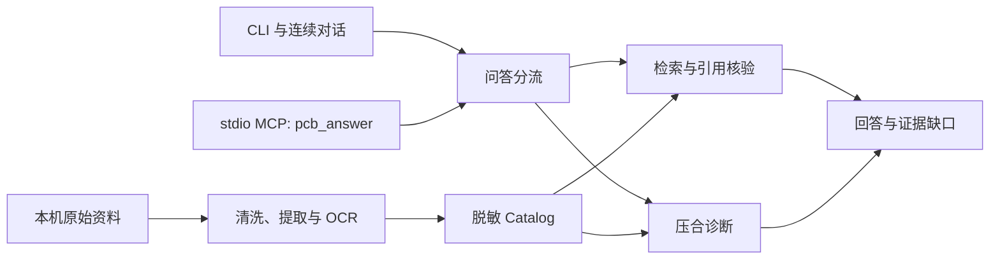

# 架构概览

| 层 | 主要模块 | 职责 |
| --- | --- | --- |
| 数据与版本 | `pcb_assistant/catalog/common.py`、`pcb_assistant/catalog/build.py`、`pcb_assistant/catalog/incremental.py` | SQLite、稳定身份、导出清单、新版本构建与增量导入 |
| 检索与证据 | `pcb_assistant/knowledge.py`、`pcb_assistant/catalog/evidence.py`、`pcb_assistant/catalog/agent.py` | 关键词收敛、有界候选、来源去重、摘录与引用 |
| 材料术语 | `pcb_assistant/materials/concepts.py` | Tg／Td／RF／GT 查询别名、完整定义与测试说明排序、适用性子问题缺口 |
| 表格字段 | `pcb_assistant/tables/` | 工作表／行／区块定位、字段追问、资料缺口 |
| 对话与分流 | `pcb_assistant/catalog/chat.py`、`pcb_assistant/router.py` | 上下文、知识与诊断路由、导出与反馈 |
| 诊断 | `agent/` | 病例事实、候选原因、本地证据和评测任务 |
| 接口 | `pcb_assistant/interfaces/` | 单工具 stdio、参数检查、信封与输出边界 |
| 可选生成 | `pcb_assistant/training/inference.py`、`pcb_assistant/interfaces/managed.py` | 本地模型或显式开启的公开证据托管综合 |
| 数据维护与评审 | `scripts/data/`、`scripts/audits/`、`scripts/evaluation/` | 独立运行的数据处理、核验与人工复核工具 |
| 可选实验 | `scripts/experimental/` | OpenViking 影子检索工具 |

根目录仅保留 `knowledge_catalog.py`、`phase6_mcp.py` 两个薄启动入口；实现分别位于 `pcb_assistant.catalog.cli` 和 `pcb_assistant.interfaces.mcp`。`agent.mcp` 也是同一协议实现的兼容入口。包内工具使用 `python -m` 启动，工作区路径由 `pcb_assistant.paths.ROOT` 统一定位。

旧 `phase6_` 模块按职责迁入 `interfaces/` 和 `evaluation/`；接口 schema 名称、协议版本及 `contracts/phase6/` 资料位置保持兼容。评测共用 `evaluation/common.py` 的复核时间检查和保序去重函数。

旧的顶层 Python 导入路径已迁移，例如 `from catalog_common import ...` 改为 `from pcb_assistant.catalog.common import ...`；`import pcb_assistant` 原来的路由模块改为 `from pcb_assistant import router`。外部自定义 Python 调用需要随之更新，CLI／MCP 客户端启动配置可继续使用已有入口。既有数据库、缓存、训练产物和本机历史验收记录未随源码迁移；依赖旧源码路径与哈希的历史维护检查会报告源码变化，不能据此改写原验收结论。

普通查询使用只读连接；来源文本是不可信数据，不能修改工具配置或执行指令。构建、增量、反馈与训练是各自显式的写入流程。检索分页只表示有界候选窗口，不保证穷尽全库。

解释与选型查询在单次调用内复用候选正文及摘录，选页后仅保留该页所需结果。来源定位信息附加到独立副本；新查询重新读取 Catalog。身份、结果指纹与 JSON 导出共用 `pcb_assistant.catalog.common.json_text`，保持稳定序列化并拒绝非有限数值。

知识引用可携带原文字符偏移和哈希；诊断展示可能合并空白，应按返回格式验证。不同引用路径的定位信息不能互相冒用。字段覆盖表示模式识别到的资料范围，不是工程参数合格判定。

材料指标的定义、比较和适用性问题进入知识解释流程；明确的缺陷排查保留诊断流程。术语别名只作用于查询，不改变既有全文索引。跨行定义仍保留连续原文及偏移；公式变量 `tD` 和 RF 射频文字不作为对应材料定义。名称、表头和定义不能确认卸压温度或实板流胶／填充时间的对应关系，回答单列尚未核实的子问题。

原始邮件归档与脱敏 Catalog 分开保存，前者不通过 MCP 暴露。外部搜索、托管综合和客户端模型的数据范围见[数据处理与隐私](DATA_PIPELINE.md)与[MCP 接入](UNIFIED_PCB_ASSISTANT.md)。
